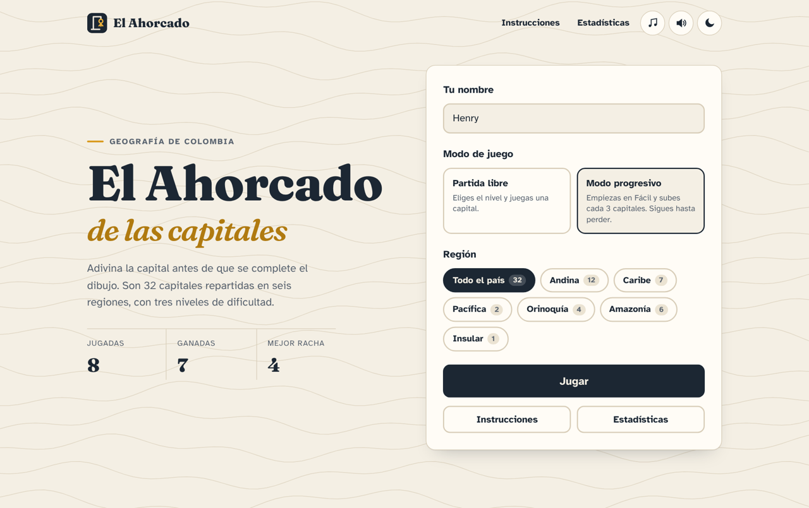
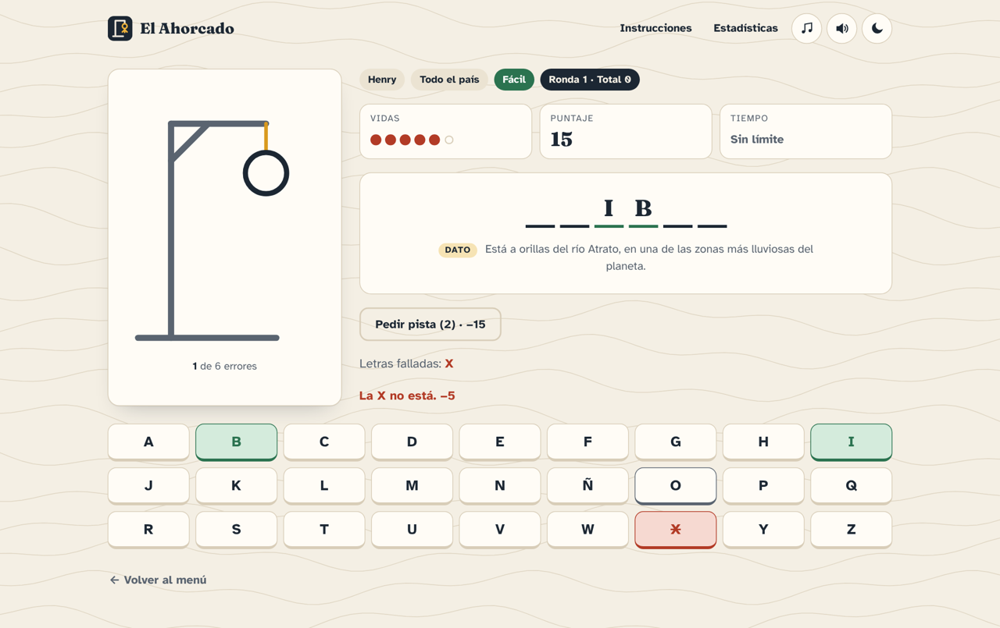
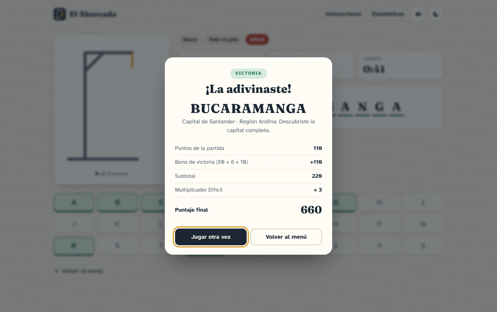
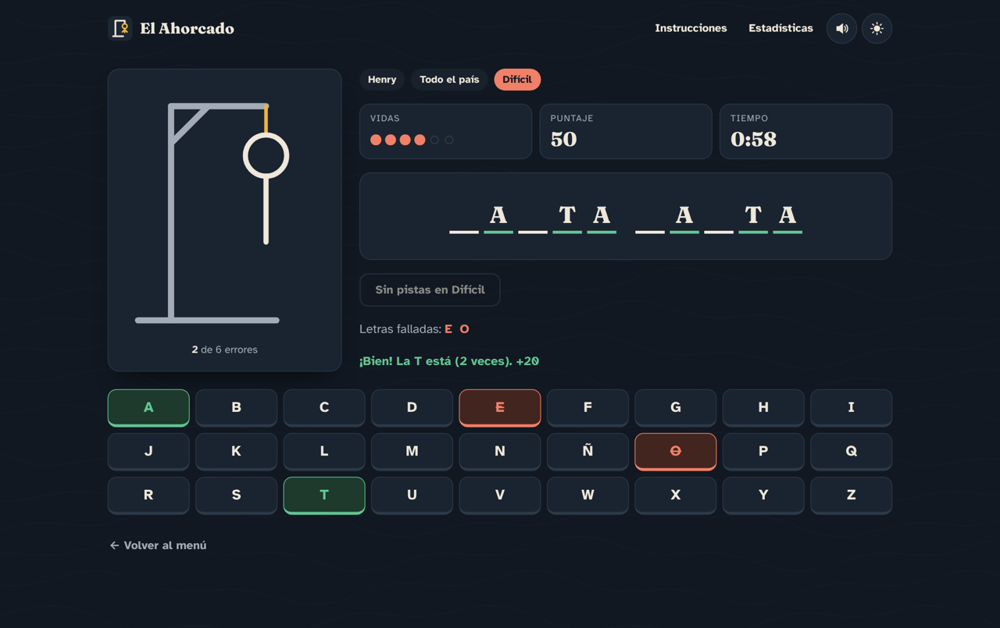
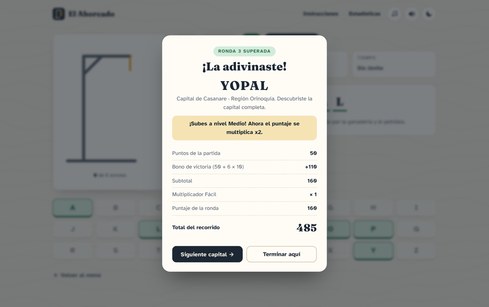
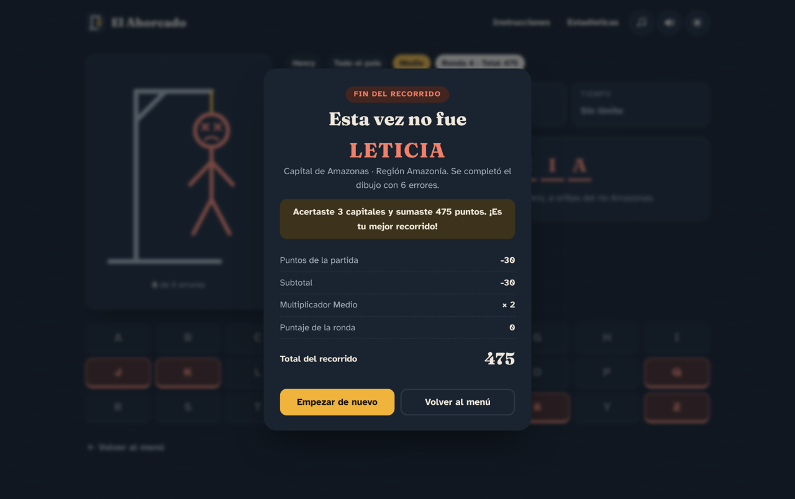
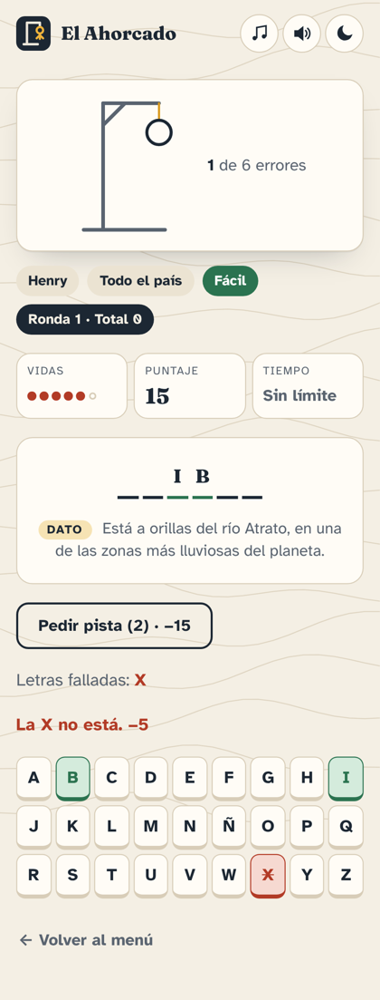

# El Ahorcado · Capitales de Colombia

Segundo parcial de Lenguajes de Programación (UDES), con el profesor Carlos Carrascal.

Es el juego del ahorcado, pero las palabras son las 32 capitales de los departamentos de Colombia. Antes de jugar se elige una región y un nivel. Si la capital está bien, se gana; si se completa el dibujo (o se acaba el tiempo en difícil), se pierde y el juego muestra la respuesta. La idea es repasar la geografía del país jugando.

**Juego en línea: https://ahorcadocapitales.vercel.app/**
**Video explicativo:** link en el archivo*

## Capturas

| Menú | Partida |
|---|---|
|  |  |
| **Victoria** | **Tema oscuro** |
|  |  |
| **Modo progresivo: subida de nivel** | **Fin del recorrido** |
|  |  |



## Qué tiene

- **Dos modos:** partida libre (eliges el nivel) y modo progresivo (empiezas en Fácil, subes cada 3 capitales y sigues hasta perder, sumando puntos). En el progresivo todas las rondas son contra el reloj.
- Cuando quedan 15 segundos baja la música y suena un tic-tac de tensión.
- Cada capital trae un dato que aparece desde el inicio, para tener contexto sin gastar pistas.
- Música de fondo propia (generada para el juego), con botón para apagarla.
- 32 capitales con su departamento y su región (Andina, Caribe, Pacífica, Orinoquía, Amazonía e Insular).
- Tres niveles según el largo de la palabra: Fácil (4 a 6 letras, 2 pistas, x1), Medio (7 a 9, 1 pista, x2) y Difícil (10 o más, sin pistas, 90 segundos, x3).
- Si una región no tiene capitales de un nivel, ese nivel queda deshabilitado. Por ejemplo, Insular solo tiene San Andrés, que es de nivel medio.
- Teclado en pantalla de la A a la Z con Ñ, y también funciona con el teclado del computador.
- Las tildes no cuentan: escribir O revela la Ó de Quibdó. La Ñ sí cuenta como letra aparte.
- Dibujo del ahorcado en SVG en 6 partes, con animación.
- Puntaje: +10 por cada aparición de la letra, −5 por fallo, −15 por pista, +50 + 10 por vida al ganar, y al final todo se multiplica según el nivel.
- Estadísticas, rachas, ranking y últimas partidas guardadas en localStorage (clave `ahorcado_stats`).
- Tema claro/oscuro y sonidos que se pueden apagar.
- Responsive desde 360 px.

Los requerimientos, las historias de usuario y el plan de pruebas están en [SPEC.md](SPEC.md).

## Tecnologías

HTML5, CSS3 (variables, Flexbox, Grid, media queries y animaciones), JavaScript ES6+ sin librerías, localStorage, Git/GitHub y Vercel.

## Cómo ejecutarlo

No necesita instalar nada ni un servidor:

1. Clonar el repositorio: `git clone https://github.com/H1RodriguezQ/Ahorcado-capitales.git`
2. Abrir `index.html` en el navegador.

Si se usa VS Code, también se puede abrir con la extensión Live Server.

## Estructura

```
ahorcado-web/
├── index.html              → menú y pantalla de juego
├── css/
│   ├── styles.css          → estilos generales y temas
│   └── responsive.css      → media queries
├── js/
│   ├── app.js              → punto de entrada, eventos y cronómetro
│   ├── juego.js            → estado, validación de letras, pistas y puntaje
│   ├── palabras.js         → banco de capitales y filtros
│   ├── ui.js               → renderizado del DOM y dibujo SVG
│   └── almacenamiento.js   → localStorage (estadísticas y preferencias)
├── assets/
│   ├── img/                → ícono, fondo y capturas
│   └── sonidos/            → música de fondo y efectos de acierto, error, victoria y derrota
├── pages/
│   ├── instrucciones.html  → reglas y tabla de capitales
│   └── estadisticas.html   → resumen, ranking e historial
├── README.md
└── SPEC.md               → requerimientos y plan de pruebas
```

## Funciones principales

| Función | Archivo | Qué hace |
|---|---|---|
| `iniciarPartida(region, nivel)` | juego.js | Reinicia el estado y elige la capital |
| `obtenerCapital(region, nivel)` | palabras.js | Filtra por región y nivel y devuelve una al azar |
| `normalizar(texto)` | juego.js | Pasa a mayúsculas y quita tildes (menos la Ñ) |
| `procesarLetra(letra)` | juego.js | Valida la letra y actualiza aciertos, errores y puntaje |
| `verificarEstado()` | juego.js | Dice si hay victoria, derrota o la partida sigue |
| `usarPista()` | juego.js | Primera pista: departamento. Segunda: una letra |
| `renderPalabra()` / `renderTeclado()` | ui.js | Pintan la palabra y el teclado |
| `dibujarAhorcado(errores)` | ui.js | Muestra las partes del SVG |
| `mostrarResultado(gano)` | ui.js | Abre la ventana con el resultado |
| `guardarEstadisticas(resultado)` | almacenamiento.js | Actualiza estadísticas y ranking |
| `iniciarRecorrido()` / `siguienteRonda()` | juego.js | Modo progresivo: arranca el recorrido y elige la siguiente capital sin repetir |
| `registrarRonda()` | juego.js | Suma la ronda al total y decide si sube de nivel |

## Pruebas

Probé los casos del plan de pruebas del documento (CP-01 a CP-14) y los de las mejoras (CP-15 a CP-21): letras correctas e incorrectas, letras repetidas, teclado físico, victoria, derrota, pistas, tiempo agotado, la Ó de Quibdó, el espacio de Santa Marta, el filtro Insular, que las estadísticas sigan después de recargar y la vista en 360 px. También revisé que la consola no muestre errores.

## Autor

Henry Rodríguez Quintero · Ingeniería de Software, Universidad de Santander (UDES)
